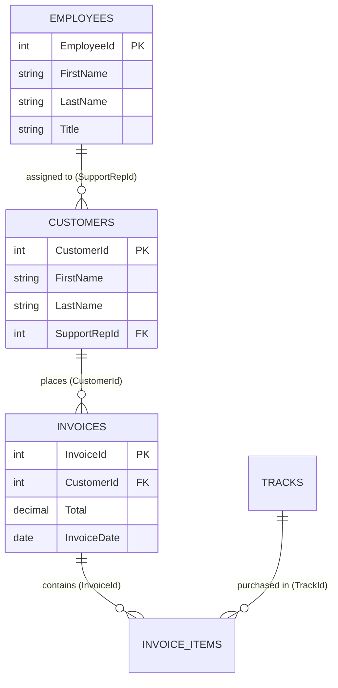

# 03. Case Study: Relational Database SQL Triage (Chinook Project)

> **Notion Page Icon:** 🗄️  
> **Tags:** `SQL` `PostgreSQL` `SQLite` `Relational Joins` `L1 Support Triage`  
> **Live Notion URL:** [chip-curler-7a4.notion.site/Queery-Chinook-Database-3f87c0a9a17a8098a683e490efeffa55](https://chip-curler-7a4.notion.site/Queery-Chinook-Database-3f87c0a9a17a8098a683e490efeffa55)  
> **Breadcrumb:** `Home / Case Studies / Chinook SQL Triage`

---

## 🎯 Project Overview & Business Problem

In an enterprise subscription or SaaS business, customer support and success operations require immediate visibility into:
1. **Account Value:** Who are our highest-paying customer accounts?
2. **Account Ownership:** Which internal employee/support representative is responsible for each account?
3. **Transaction History:** Have their recent invoices cleared, or are there billing discrepancies?

In this case study, I analyzed the **Chinook Database** (an industry-standard relational model of an international digital media store) to write multi-table queries that join customer accounts, billing invoices, and internal support staff records.

---

## 🗺️ Relational Schema & Entity Relationships

The query navigates between three core entities connected by foreign keys:



---

## 💻 The Multi-Table SQL Query

```sql
-- Objective: Identify Top 5 Customers by Lifetime Spending and their Assigned Support Rep
SELECT 
    c.CustomerId, 
    c.FirstName || ' ' || c.LastName AS Customer_Name,
    e.FirstName || ' ' || e.LastName AS Support_Rep,
    ROUND(SUM(i.Total), 2) AS Total_Spent
FROM customers c
INNER JOIN invoices i 
    ON c.CustomerId = i.CustomerId
INNER JOIN employees e 
    ON c.SupportRepId = e.EmployeeId
GROUP BY 
    c.CustomerId, 
    Customer_Name, 
    Support_Rep
ORDER BY 
    Total_Spent DESC 
LIMIT 5;
```

---

## 🔍 Line-by-Line Technical Breakdown

*(In Notion, set each of these up as a Toggle List for a clean, interactive reading experience)*

▶ **1. `SELECT` & String Concatenation (`||`)**
* `c.FirstName || ' ' || c.LastName`: Joins customer first and last names cleanly for readable output.
* `ROUND(SUM(i.Total), 2)`: Aggregates all invoice amounts per customer and rounds to 2 decimal places for financial reporting.

▶ **2. `INNER JOIN invoices i ON c.CustomerId = i.CustomerId`**
* Matches invoices to customer records using the primary key / foreign key pair `CustomerId`.
* Guarantees that only customers who have placed at least one order are calculated.

▶ **3. `INNER JOIN employees e ON c.SupportRepId = e.EmployeeId`**
* **Crucial for Support Operations:** Navigates from customer account back to internal staff through `SupportRepId`.
* Enables filtering by individual support agent queue workloads.

▶ **4. `GROUP BY` & `ORDER BY Total_Spent DESC LIMIT 5`**
* Groups results at the granular customer and representative level so `SUM()` aggregates correctly.
* Sorts descending by total expenditure, isolating the top 5 high-value accounts.

---

## 📊 Sample Output Results

| CustomerId | Customer_Name | Support_Rep | Total_Spent |
| :---: | :--- | :--- | :---: |
| **6** | Helena Holý | Steve Johnson | **$49.62** |
| **26** | Richard Cunha | Jane Peacock | **$47.62** |
| **57** | Luis Rojas | Steve Johnson | **$46.62** |
| **1** | Luís Gonçalves | Jane Peacock | **$39.62** |
| **3** | François Tremblay | Jane Peacock | **$39.62** |

---

## 🛡️ Real-World Application to L1 Technical Support

How this SQL skill directly solves real-world customer support problems:
1. **Fast Account Verification:** When a customer reports a missing invoice or tier downgrade, I can run a query to verify actual paid totals vs. active account tier.
2. **Escalation Routing:** If an issue requires account manager intervention, I can query the customer's `SupportRepId` and assign the ticket directly without delaying the user.
3. **Data Integrity Checks:** Identifying orphaned customer accounts (`SupportRepId IS NULL`) that may have been missed during user onboarding migrations.
