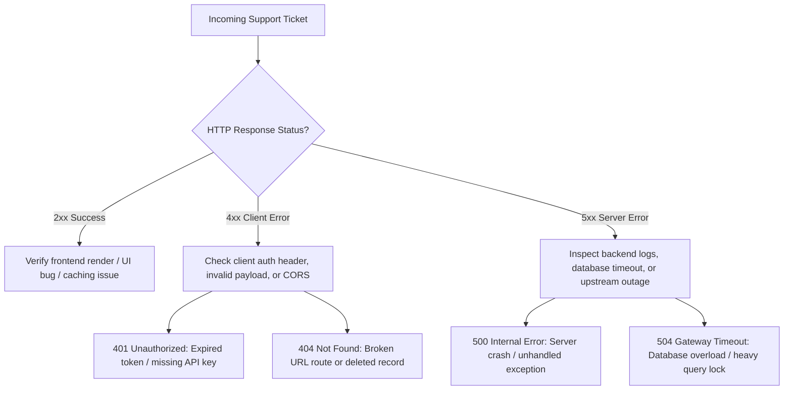

# 06. "Currently Learning" Lab & Diagnostic Sandbox

> **Notion Page Icon:** 🌱  
> **Tags:** `Continuous Learning` `Python` `Bash` `Terminal` `L1 Triage Lab`  
> **Breadcrumb:** `Home / Diagnostic Lab & Continuous Learning`

---

## 🎯 The Sincerity Philosophy

> *"The best junior support engineers aren't the ones who claim to know everything—they are the ones who are self-driven, take honest stock of their gaps, and continuously practice real technical skills outside of class."*

This page serves as my **live, transparent learning journal**, documenting the hands-on technical competencies I am actively practicing to support modern SaaS and cloud environments.

---

## 💻 Track 1: Bash & Unix Command-Line Navigation

In cloud and remote SaaS environments, investigating server behavior requires navigating the terminal.

### Commands Practiced & Lab Objectives:

| Command | Syntax Practiced | Support Scenario Application |
| :--- | :--- | :--- |
| **`cat` & `head` / `tail`** | `tail -n 50 -f /var/log/app.log` | Following live server log streams during customer checkout errors. |
| **`grep`** | `grep -i "ERROR 500" server.log \| grep "user_4910"` | Isolating error traces specifically tied to a complaining customer account. |
| **Piping `\|` & `wc -l`** | `grep "404" access.log \| wc -l` | Counting broken endpoint hits to evaluate incident severity. |
| **File Permissions** | `ls -la`, `chmod 644` | Verifying configuration file read/write permissions for web services. |
| **Network Probing** | `curl -I https://api.service.com/health` | Verifying API endpoint availability and HTTP response status headers. |

---

## 🐍 Track 2: Python for Support Automation

### 1. Parsing API JSON Payloads
Practicing reading unstructured JSON error payloads returned by customer API webhooks:

```python
import json

# Sample simulated SaaS webhook payload
raw_payload = '''{
    "event": "payment_failed",
    "customer_id": "cus_98231",
    "error": {
        "code": "insufficient_funds",
        "gateway_response": "Decline 51"
    },
    "attempt_count": 3
}'''

def diagnose_webhook(payload_str):
    data = json.loads(payload_str)
    customer = data.get("customer_id")
    err_code = data.get("error", {}).get("code")
    attempts = data.get("attempt_count")
    
    print(f"[TRIAGE] Customer {customer} failed with error '{err_code}' after {attempts} attempts.")
    if attempts >= 3:
        print("[ACTION] Escalate to Billing Operations or trigger automated re-auth email.")

diagnose_webhook(raw_payload)
```

---

## 🎫 Track 3: HTTP Status Codes & Triage Mental Model

When a ticket arrives, I categorize the failure domain using standard HTTP protocol standards:



---

## 📅 Weekly Self-Study Tracker

| Week / Period | Primary Focus Area | Milestones Completed |
| :--- | :--- | :--- |
| **October 2025** | SQL Database Deep Dive | Completed DataRockie SQL Crash Course; mastered multi-table joins. |
| **November 2025** | Spreadsheets & Regex | Built Thai-to-ISO date converter and ID card parsing regex rules. |
| **December 2025** | Business Intelligence & Reporting | Completed Microsoft Thailand Power BI for Beginners course. |
| **January 2026** | Terminal & Linux Basics | Practiced grep, log streaming, and directory navigation in Linux shell. |
| **Currently** | Python Automation & L1 Runbooks | Writing automated log parsers and practicing ticket triage simulations. |
